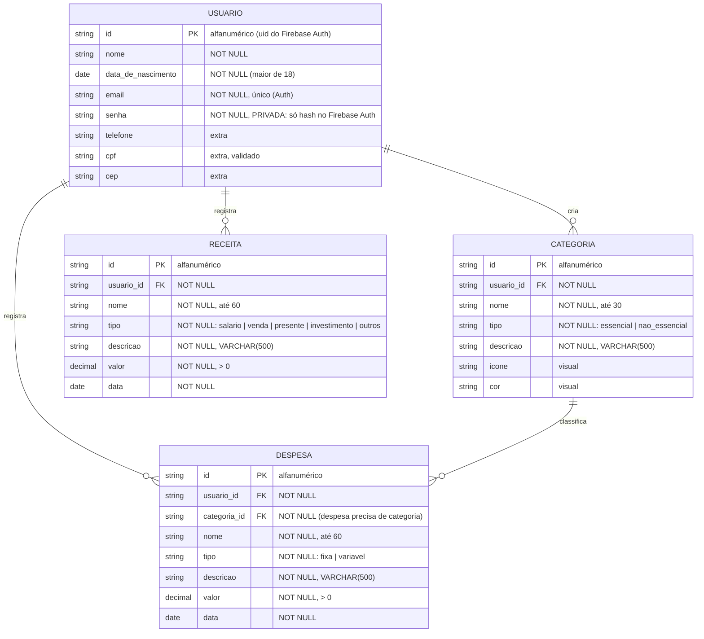

# MER — OpenFinance

## Cardinalidades e regras de negócio
| Regra | Onde é garantida |
|---|---|
| Uma despesa tem **exatamente uma** categoria; uma categoria tem **várias** despesas | `categoriaId NOT NULL` + `FOREIGN KEY` (SQLite), `exists(...)` (regras Firestore), validação na tela |
| Categoria com despesas **não pode ser excluída** | `ON DELETE RESTRICT` (SQLite) + checagem em `deleteCategory` |
| Um usuário tem **várias** categorias, despesas e receitas, e só vê as suas | caminho `users/{uid}/...` + regras Firestore + coluna `usuarioId` |
| `nome`, `tipo`, `descricao` obrigatórios; `descricao` até **500** caracteres | `CHECK` (SQLite), regras Firestore, validação + contador na tela |
| `valor > 0`, `data` válida (YYYY-MM-DD) | `CHECK` (SQLite), regras Firestore, validação |
| **Senha privada** | Nunca é gravada no SQLite nem no Firestore; o Firebase Auth guarda só o hash |
| ID alfanumérico | `newId()` (offline) / `uid` do Auth (usuário) |

> `usuario_id`/`categoria_id` aparecem no diagrama em snake_case; no código são `usuarioId`/`categoriaId`.
